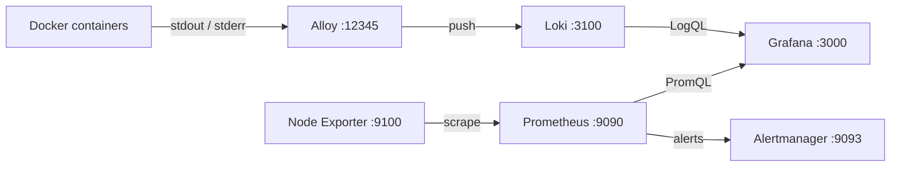

# Monitoring Lab

A small observability stack I run with Docker Compose: container logs go through Grafana Alloy into Loki, Prometheus scrapes host metrics from Node Exporter, Grafana sits on top of both, and Alertmanager receives the alerts.

I built it to practice the full loop on something real: collect, store, query, alert, and check that the alert actually fires (and resolves) when something breaks.

**Stack:** Docker Compose, Grafana, Loki, Grafana Alloy, Prometheus, Node Exporter, Alertmanager, PromQL, LogQL


## Architecture



Each component has its own `docker-compose.yml`. They all join an external Docker network called `applications-network`, so services reach each other by name (`loki:3100`, `alertmanager:9093`, etc.).

## Getting started

```bash
docker network create applications-network

docker compose -f loki/docker-compose.yml up -d
docker compose -f alloy/docker-compose.yml up -d
docker compose -f prometheus/docker-compose.yml up -d
docker compose -f alertmanager/docker-compose.yml up -d
docker compose up -d   # Grafana
```

| Service      | URL                    |
|--------------|------------------------|
| Grafana      | http://localhost:3000  |
| Prometheus   | http://localhost:9090  |
| Alertmanager | http://localhost:9093  |
| Alloy UI     | http://localhost:12345 |

## Logs: Alloy → Loki

Alloy discovers containers through the Docker socket, so nothing has to be configured per container. The pipeline in `alloy/config.alloy`:

```
discovery.docker → discovery.relabel → loki.source.docker → loki.process → loki.write
```

Every stream gets a few labels (`container`, `platform=docker`, `environment=lab`), which makes filtering in Grafana straightforward:

```logql
{container="nginx-test-2"} |= "GET /"
```

## Metrics: Prometheus + Node Exporter

Prometheus scrapes itself and Node Exporter every 15 seconds. The config and alert rules live in Git:

```
prometheus/
├── prometheus.yml
└── rules/
    └── alerts.yml
```

## Alerting

One rule for now: alert when Node Exporter has been unreachable for more than one minute.

```yaml
- alert: NodeExporterDown
  expr: up{job="node-exporter"} == 0
  for: 1m
  labels:
    severity: critical
```

I tested the whole failure and recovery path by stopping the container:

1. `docker stop node-exporter`: Prometheus sees `up == 0`
2. The rule goes `pending`, then `firing` after one minute
3. Alertmanager receives `NodeExporterDown`
4. `docker start node-exporter`: `up` goes back to 1 and the alert resolves

Useful checks while testing:

```bash
curl -s localhost:9090/api/v1/alertmanagers | jq .
curl -s localhost:9090/api/v1/rules | jq '.data.groups[].rules[] | {name, state, health}'
curl -s localhost:9093/api/v2/alerts | jq '.[] | {alert: .labels.alertname, status: .status.state}'
```

## How I work on it

Changes are made locally on a `feature/*` branch, tested, then merged into `main` through a pull request before being deployed to my VPS. I don't edit config directly on the server.

## Project structure

```
monitoring-lab/
├── alertmanager/
│   ├── alertmanager.yml
│   └── docker-compose.yml
├── alloy/
│   ├── config.alloy
│   └── docker-compose.yml
├── loki/
│   └── docker-compose.yml
├── prometheus/
│   ├── docker-compose.yml
│   ├── prometheus.yml
│   └── rules/
│       └── alerts.yml
├── docker-compose.yml
└── README.md
```

## What's next

- Send notifications from Alertmanager (email or Slack)
- Grafana dashboards provisioned as code
- Move the same setup to Kubernetes (K3s) with Helm and Argo CD
- Instrument my BMI calculator app (Spring Boot + Micrometer) and add application-level alerts
